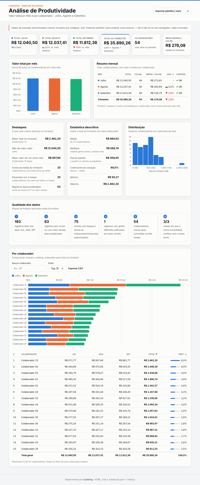

# 📊 Análise de Produtividade



🔗 **[Ver o painel funcionando](https://ivanlcaladomoura.github.io/painel-analise-produtividade/)**

Painel web de análise de dados que transforma uma planilha Excel de produtividade (Julho, Agosto e Setembro) em um dashboard interativo, feito com **HTML, CSS e JavaScript puro** + [Chart.js](https://www.chartjs.org/).

> Os dados de exemplo são reais, mas **anonimizados**: os nomes dos colaboradores foram trocados por códigos.

## O que o painel mostra

- **Indicadores (KPIs):** total por mês, total do trimestre, nº de colaboradores e média mensal por colaborador, com variação mês a mês
- **Resumo mensal** com checagem de integridade (“Confere”): a soma consolidada precisa bater com a soma bruta de cada mês
- **Destaques:** líder do trimestre, mês de maior valor, maior valor individual, quantos estão acima da média
- **Estatística descritiva:** média, mediana, desvio padrão, coeficiente de variação, mínimo e máximo
- **Distribuição (histograma)** dos totais por faixa de R$ 250
- **Qualidade dos dados:** quantos registros foram lidos, descartados, padronizados e unificados
- **Ranking por colaborador** com gráfico de barras empilhadas, busca, ordenação por coluna e exportação para CSV

## Pipeline de dados

```
Abas JUL / AGO / SET (nome, valor)
  → limpeza: remove espaços extras, padroniza maiúsculas, unifica grafias diferentes
  → descarte: nome em branco/"0" ou valor zerado
  → consolidação: soma por colaborador em cada mês
  → cálculos: totais, médias, variação %, ranking, participação, estatísticas
  → visualização: KPIs, tabelas e gráficos
```

Toda a lógica que a planilha fazia com `SUMPRODUCT`, `COUNTIF` e `INDEX/MATCH` foi reescrita em funções JavaScript puras (PARTE 3 do `script.js`).

## Importar outra planilha

O botão **Importar planilha (.xlsx)** aceita um arquivo com as abas `JUL`, `AGO` e `SET`, cada uma com as colunas `NOME` e `Total`. O arquivo é lido **somente no navegador** (via [SheetJS](https://sheetjs.com/)) — nada é enviado para servidor.

## Como rodar

Basta abrir o `index.html` no navegador. Não precisa instalar nada.

## Estrutura

```
├── index.html   # estrutura da página
├── style.css    # visual, tema claro/escuro e responsividade
└── script.js    # dados, análise, gráficos e interações
```

## Tecnologias

HTML5 · CSS3 (variáveis, Grid, Flexbox, media queries) · JavaScript (ES6+) · Chart.js · SheetJS

---

Desenvolvido por **CodeDog**
